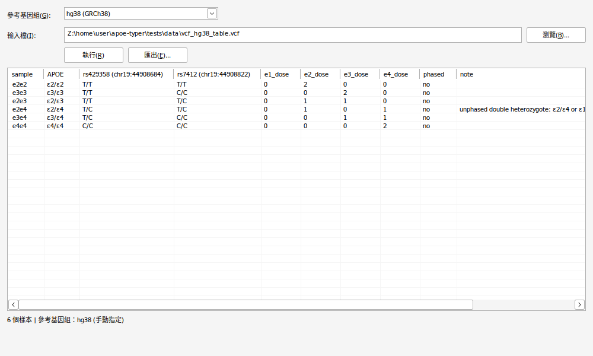

# apoe-typer

Call the APOE genotype (ε1–ε4) from the two APOE SNPs in a VCF or gVCF file, with a Windows app or a command line.

**Status:** research use, not a validated clinical test. **Version:** v0.2.0. **Platforms:** the GUI runs on 64-bit Windows 10 and later; the CLI builds on Linux and Windows.

APOE ε2, ε3, and ε4 are defined by two SNPs, rs429358 and rs7412. Pipelines rarely report them as one result, and the answer depends on genome build, phasing, and gVCF coverage. apoe-typer reads the two sites, applies the rules in one place, and writes one row per sample with doses, phasing, and a note for every unusual call. The calling logic follows [apoe-genotyper](https://github.com/Biomedical-Genetics/apoe-genotyper) and a laboratory APOE lookup table.

## Install

**Windows (no installation).** Download `apoe-typer-gui_v0.2.0.exe` from the [latest release](https://github.com/oumarkme/apoe-typer/releases/latest) and double-click it. The file is self-contained: no Visual C++ Redistributable, no Python, no administrator rights. The exe is unsigned, so SmartScreen may warn on the first run. Check the download against the `.sha256` file in the release.

**Linux or Windows CLI.** Install [Rust](https://rustup.rs) (stable), then:

```sh
git clone https://github.com/oumarkme/apoe-typer.git
cd apoe-typer
cargo build --release          # target/release/apoe-typer
```

## Quick start

```sh
target/release/apoe-typer -r hg38 tests/data/vcf_hg38_table.vcf
```

```text
sample	APOE	rs429358 (chr19:44908684)	rs7412 (chr19:44908822)	e1_dose	e2_dose	e3_dose	e4_dose	phased	note
e2e2	ε2/ε2	T/T	T/T	0	2	0	0	no	
e3e3	ε3/ε3	T/T	C/C	0	0	2	0	no	
e2e3	ε2/ε3	T/T	T/C	0	1	1	0	no	
e2e4	ε2/ε4	T/C	T/C	0	1	0	1	no	unphased double heterozygote: ε2/ε4 or ε1/ε3; reported ε2/ε4 (ε1 is very rare)
e3e4	ε3/ε4	T/C	C/C	0	0	1	1	no	
e4e4	ε4/ε4	C/C	C/C	0	0	0	2	no	
```

In the Windows app, choose the VCF (browse, drag and drop, or pass the path as an argument), pick the reference build or leave **Auto**, and press **Run**. Results can be exported as TSV, CSV, or TXT (UTF-8 with BOM, so Excel shows ε correctly).



## Usage

```text
apoe-typer [OPTIONS] [INPUT]
```

| Option | Meaning |
|---|---|
| `INPUT` | VCF or gVCF (`.vcf`, `.vcf.gz`, bgzip, `.g.vcf.gz`). Omitted or `-` reads stdin. BCF is not supported (`bcftools view -Ov` first). |
| `-r, --ref <BUILD>` | `hg19`, `hg38`, or `hs1` (T2T-CHM13v2.0). Omitted: detected from the VCF header, otherwise hg38 is assumed and reported on stderr. A build that contradicts the header is an error. |
| `-o, --output <FILE>` | `.csv` writes RFC 4180 CSV; any other name writes TSV. Omitted: TSV to stdout. |
| `-v`, `-h` | Version, help. |

Exit status: 0 success, 1 runtime error (unreadable file, malformed VCF, build mismatch), 2 invalid arguments. Only the table goes to stdout; diagnostics go to stderr, so the tool works in pipelines:

```sh
bcftools view -Ov sample.vcf.gz | apoe-typer -r hg38 > result.tsv
```

Output columns: `sample`, `APOE`, the two genotypes, `e1_dose` to `e4_dose` (copies of each allele, or `NA`), `phased` (both SNPs in one phase set), and `note`. The full column and note reference is in the [manual](docs/MANUAL.zh-TW.md) (Traditional Chinese).

## How it works

1. The reader detects plain, gzip, and multi-block bgzip input, and skips a UTF-8 BOM and CRLF line endings.
2. The two sites are taken from the selected build:

   | Build | rs429358 (T>C) | rs7412 (C>T) |
   |---|---|---|
   | hg19 | chr19:45411941 | chr19:45412079 |
   | hg38 | chr19:44908684 | chr19:44908822 |
   | hs1 | chr19:47733380 | chr19:47733518 |

3. Each sample's genotypes give two haplotypes: ε1 = C/T, ε2 = T/T, ε3 = T/C, ε4 = C/C (rs429358 / rs7412). Unphased double heterozygotes are reported as ε2/ε4, with a note that ε1/ε3 is possible but very rare.
4. A site missing from a gVCF is called from reference blocks (`<NON_REF>`, `<*>`, Strelka `END=`). A site not covered by any record is a no-call, and with an unconfirmed build it is never assumed to be reference.
5. Indels, MNPs, spanning deletions, REF mismatches, non-diploid genotypes, and missing calls are reported in `note` and never guessed.

The behavior is specified in [docs/SPEC.md](docs/SPEC.md).

## Limits

- Only rs429358 and rs7412 are read; other APOE variants are out of scope.
- The reference build must match the VCF. Pass `-r` when the header carries no contig information.
- Results are for research. Treat `NA`, `./.`, and any row with a `note` as needing manual review.

## Build the Windows exe

`scripts/build_windows.sh` cross-compiles the GUI from Linux with [cargo-xwin](https://github.com/rust-cross/cargo-xwin) (`x86_64-pc-windows-msvc`), links the C runtime statically, remaps build paths, and writes `dist/apoe-typer-gui_v<version>.exe` with its SHA-256. It needs `lld`, `llvm-rc`, and `clang-cl` on the PATH. Set a local `CARGO_TARGET_DIR` when the project sits on a network share.

## Test

```sh
cargo test --release
```

The suite covers parsing, all three builds, gVCF dialects, the CLI, and a differential check against a reference script (127 tests). `scripts/test-wine.sh` runs the same suite on the Windows target under wine.

## Help and contributing

Report bugs and questions in the [issue tracker](https://github.com/oumarkme/apoe-typer/issues). Pull requests are welcome; run `cargo fmt`, `cargo clippy`, and `cargo test` first. The original calling logic is by the [Biomedical-Genetics](https://github.com/Biomedical-Genetics/apoe-genotyper) group.
